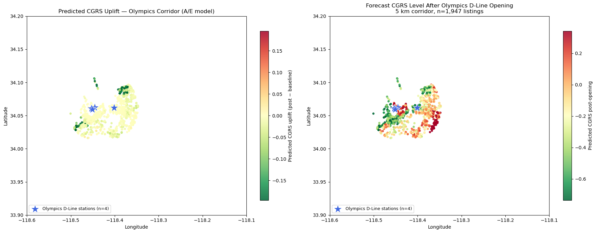

# Transit-Induced Gentrification: The LA Metro D Line Extension and the 2028 Olympics

Can we predict which neighborhoods along the LA Metro D Line (Purple) extension to Westwood face the highest gentrification and displacement risk once the line opens ahead of the 2028 Olympics?

This project builds a **Composite Gentrification Risk Score (CGRS)** from rental listings and Census ACS data, learns how proximity to existing Metro stations relates to that score, and uses the trained models to forecast the shift in risk along the new D Line corridor.

Group project for **MAS 405, UCLA (Spring 2026)** by Jon Darius, Mercy Eme, Judith Mendoza, Layla Rainosek and Daniel Rocha.



## Approach

1. **Data**: ~21,800 geocoded LA rental listings, ACS 5-year estimates (2019 and 2024) at the ZIP code (ZCTA) level, and LA Metro rail station coordinates.
2. **Feature engineering**: distance to the nearest station and to the planned Olympics D Line stations, distance bands (0-0.5, 0.5-1, 1-2, 2-5 mi), and change in rent, income, education and poverty between 2019 and 2024.
3. **Exploratory analysis**: CGRS distribution, distance decay, and transit-oriented development (TOD) premium tests.
4. **Models**: OLS and Ridge baselines, Random Forest and XGBoost, evaluated with 5-fold cross-validation. The primary model is trained on the A and E Line corridors, the lines most comparable to the D Line extension; an all-lines model serves as a robustness check.
5. **Forecast**: for listings within 5 km of the planned D Line stations, simulate the line opening (station 0.3 km away, inside the TOD buffer), re-score them with the Random Forest model, and map the change in CGRS.

## Key findings

- Listings within 0.5 miles of a station have significantly higher CGRS than those farther away (Mann-Whitney p ≈ 0).
- Tree models substantially outperform linear baselines on the A/E corridor model (5-fold CV R²: XGBoost 0.88, Random Forest 0.84, OLS 0.45).
- Partial dependence shows CGRS declining with distance from the nearest station, consistent with a TOD effect.
- See the [research paper](reports/research_paper.pdf) and [executive summary](reports/executive_summary.pdf) for full results.

## Repository layout

```
transit_gentrification_analysis.ipynb   full analysis notebook (with outputs)
data/                                   ACS extracts and Metro station list
figures/                                charts produced by the notebook
reports/                                research paper and executive summary (PDF)
```

## Running it

```bash
pip install -r requirements.txt
cp .env.example .env        # add a free Census API key (optional, cached ACS CSVs are included)
jupyter notebook transit_gentrification_analysis.ipynb
```

The rental listings file (`data/housing_combined_data_geocoded.csv`) comes from MLS data and is **not included** in this repository, so the modeling cells will not run without it. The notebook is saved with outputs so results and charts can be viewed directly on GitHub.

## Data sources

- U.S. Census Bureau, American Community Survey 5-year estimates (2019, 2024)
- LA Metro GTFS rail stop data
- MLS rental listings (not redistributed)
